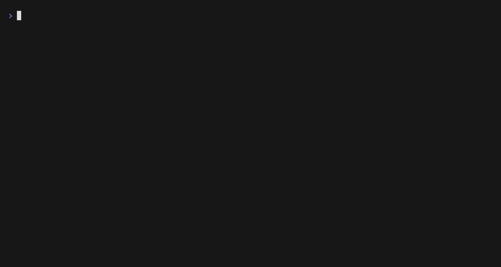
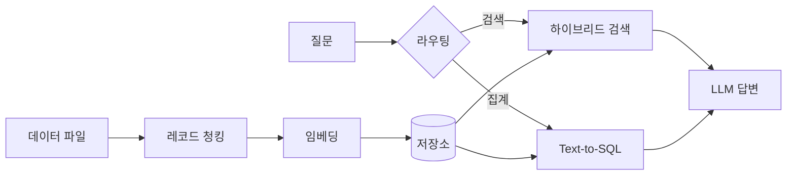

# 🤖 OBot

> 데이터 파일만 넣으면, API로 바로 쓰는 RAG 챗봇 서버



---

## 💭 문제 인식

RAG 챗봇 하나 만들려면 청킹, 임베딩, 벡터 DB, 프롬프트까지 매번 새로 짜야 했다
JSON이나 CSV는 글자 수로 자르면 데이터 한 건이 중간에 쪼개지고,
"제일 비싼 거 뭐야?" 같은 질문에는 답도 못 한다.

**이 문제를 해결하기 위해 직접 만들게 되었다.** 파일 넣고 실행하면 끝나는 챗봇 서버.
---
## ✨ 핵심 특징

| | |
|---|---|
| **파일 첨부 ** | JSON · JSONL · CSV 자동 처리 |
| **레코드 단위 청킹** | 데이터 한 건이 쪼개지지 않음 |
| **하이브리드 검색** | 의미 + 키워드 검색 (bge-m3) |
| **집계 질문 지원** | 자주 질문 되는 점 → SQL로 처리 |
| **LLM 자유 선택** | Ollama · Claude · GPT |
| **API 서버** | 어떤 프로젝트에서든 HTTP로 호출 |

---

## 🗺 파이프라인



---

## 🚀 빠른 시작

### 로컬

```bash
uv sync
cp examples/* data/            # 샘플 데이터: orders.csv, products.json, reviews.jsonl
uv run obot ask orders "주문이 총 몇 건이야?"
uv run obot serve              # http://127.0.0.1:8000/docs
```

기본 LLM은 로컬 Ollama의 `qwen2.5:7b`입니다. `ollama pull qwen2.5:7b`로 먼저 받아 두세요.
첫 실행 때 임베딩 모델(bge-m3, 약 2.3GB)을 내려받습니다.

### Docker

```bash
docker build -t obot .
docker run -p 8000:8000 --env-file .env \
  -v ./examples:/app/data \
  -v obot-storage:/app/storage \
  -v obot-hf:/app/.cache/huggingface \
  obot
```

- 컨테이너 설정은 `docker/config.yaml`입니다(`0.0.0.0`으로 열고, 호스트의 Ollama에 `host.docker.internal`로 연결). 바꾸려면 `-v ./my-config.yaml:/app/config.yaml`로 덮어쓰세요.
- Linux에서는 `--add-host=host.docker.internal:host-gateway`를 추가하세요.
- `.env`가 없으면 `--env-file`을 빼면 됩니다. 이미지에는 `.env`가 들어가지 않습니다.
- `--env-file`은 따옴표를 벗기지 않습니다. `.env`는 따옴표 없이 `KEY=value` 형식으로 쓰세요.
- 모델 캐시(`obot-hf`)와 빌드 결과(`obot-storage`)는 볼륨에 남아서, 재시작하면 다시 받거나 다시 빌드하지 않습니다.
- 서버가 떠 있는 동안에는 저장소가 잠겨서 `docker exec ... obot build`나 `obot ask`를 쓸 수 없습니다. 다시 빌드하려면 `POST /bots/{name}/rebuild`를 쓰세요.

---

## 🔌 API

```bash
curl -X POST localhost:8000/bots/products/chat \
  -H "Content-Type: application/json" \
  -d '{"message": "무선 마우스 추천해줘"}'
```

검색 질문은 근거 레코드를 `sources`로 돌려줍니다.

```json
{"answer": "...", "route": "search", "sources": [{"id": "P-1001", "score": 0.032, "record": {"...": "..."}}], "sql": null}
```

집계 질문은 실행한 SQL과 결과를 `sql`로 돌려줍니다.

```json
{"answer": "주문은 총 28건입니다.", "route": "aggregate", "sources": [], "sql": {"query": "SELECT COUNT(*) FROM records", "rows": [{"COUNT(*)": 28}]}}
```

| 엔드포인트 | 설명 |
|---|---|
| `GET /health` | 상태 확인 |
| `GET /bots` | 봇 목록과 빌드 상태 |
| `GET /bots/{name}` | 레코드 수, 스키마 |
| `POST /bots/{name}/chat` | 질문 (`message`, 선택: `history`, `top_k`) |
| `POST /bots/{name}/rebuild` | 다시 빌드 |

`.env`에 `OBOT_API_KEY`를 넣으면 API 키 인증이 켜집니다. 요청 헤더에 `X-API-Key`를 넣으세요.

> 봇 하나당 레코드는 20,000건까지 지원합니다(Qdrant 로컬 모드 기준).

---

## ⚙️ 설정

```yaml
# config.yaml
llm:
  provider: ollama   # ollama | anthropic | openai
  model: qwen2.5:7b
```

API 키는 `.env`에 입력. 임베딩 모델은 `bge-m3`로 고정.

---

## 🛠 기술 스택

| 구분 | 기술 |
|---|---|
| 서버 | Python, FastAPI, uv |
| 임베딩 | BAAI/bge-m3 |
| 저장소 | Qdrant (로컬), SQLite |
| LLM | Ollama / Anthropic / OpenAI |

---

## 📁 프로젝트 구조

```
obot/
├── src/obot/
│   ├── core/      # 로드, 청킹, 임베딩, 검색, 답변 생성
│   ├── llm/       # LLM provider 어댑터
│   └── api/       # FastAPI 서버
├── data/          # 사용자 데이터
├── examples/      # 샘플 데이터
├── docker/        # 컨테이너용 config.yaml
├── docs/          # 데모 GIF와 vhs 스크립트
├── Dockerfile
└── config.yaml
```

---

## ✅ 개발 계획

- [x] 설계: 요구사항, 설정 구조 확정
- [x] 파일 로드 + 스키마 분석
- [x] 레코드 단위 청킹 + bge-m3 임베딩
- [x] 검색 + LLM 답변 생성
- [x] FastAPI 서버 + 자동 빌드
- [x] 하이브리드 검색 (dense + sparse)
- [x] 집계 질문 SQL 처리
- [x] Docker, 샘플 데이터, 데모 GIF

---

## 📚 참고

- Lewis et al., [Retrieval-Augmented Generation for Knowledge-Intensive NLP Tasks](https://arxiv.org/abs/2005.11401), NeurIPS 2020
- Chen et al., [BGE M3-Embedding](https://arxiv.org/abs/2402.03216), 2024
- [FastAPI 공식 문서](https://fastapi.tiangolo.com)
- [BAAI/bge-m3](https://huggingface.co/BAAI/bge-m3)

---

## 📄 License

MIT
